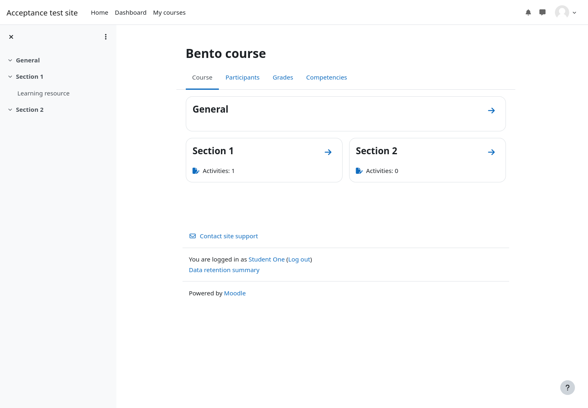
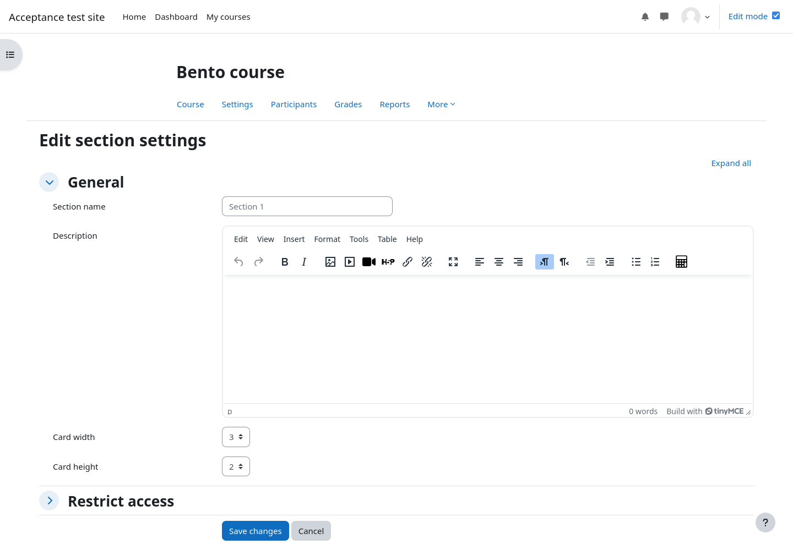

# Bento

Bento arranges course sections as responsive cards. Learners open a card to study its section using Moodle’s standard activity pages. Teachers can give sections different card sizes and images while retaining native course editing.

Bento 1.0.0-rc1 is a review candidate. Local compatibility validation is complete; manual app and accessibility review and Marketplace submission remain pending. It is not a Marketplace-approved release.

## Key features

- Responsive section cards with widths from one to three columns and heights from one to two rows. Narrow layouts return to one column without clipping text.
- Native section navigation, completion, conditional access, course index and subsection output.
- Teacher-controlled section images, stored separately from course format options.
- Saved-card previews with keyboard-accessible dialogs and ordinary page fallbacks.
- A read-only layout web service that filters sections for the current user.
- Explicit conversion from a pinned Tiles version, with a source-state preview and confirmation.

## Screenshots

These screenshots use fictional demonstration data from the local Moodle 4.5 validation site.

*Learners open section cards while retaining Moodle’s course index and activity counts.*

*Teachers choose card spans in Moodle’s section settings form.*

## Requirements

The 1.0.0-rc1 candidate has passed local installation, static, PHPUnit and browser checks on Moodle 4.5, 5.0, 5.1, 5.2 and 5.3 with PostgreSQL and MariaDB.

Bento depends on the core Topics format. It does not require a paid service, external account, third-party library or administrator-run build step. Standard Moodle App section navigation is intended; the browser card grid is not a custom mobile-app interface.

## Installation

Moodle Marketplace publication is pending.

A release package is not yet approved for installation on production sites. Once an approved ZIP is supplied, install it through **Site administration > Plugins > Install plugins**. The package contains a single `bento` directory. Select **Bento** in the course format setting.

## Configuration and use

With editing enabled, edit a section to choose its **Card width** and **Card height**. These values describe grid spans; they do not impose fixed pixel dimensions. The general section remains above the cards. The grid follows course order and does not use visual packing that changes reading order.

Use **Edit section image** to upload a PNG, JPEG or WebP image of up to 5 MB. Removing the file and saving removes the image. Images are decorative: the section heading provides the link’s accessible name. **Preview card** previews the saved image and content; save changes before previewing them.

Turning editing off displays the learner overview. Selecting a section opens its standard Moodle section page. Moodle continues to decide which sections, activities, completion information and access restrictions each learner can see.

### Converting from Tiles

Conversion targets Tiles 4.5.0.28 (build 2025070355) on Moodle 4.5. Other source versions and Moodle branches are rejected. Conversion tests passed on PostgreSQL and MariaDB. Tiles is optional and is not needed for ordinary Bento courses.

For an eligible Tiles course, a teacher with course-update permission can choose **Convert from Tiles** from the course menu. Review the preview before confirming. Take a course backup first. Interactive conversion is limited to 200 sections (including General) and 50 MB of source images; larger courses are refused without changes and need a planned migration.

Conversion preserves existing course sections and activities, copies compatible section photos, and retains the original Tiles files. Existing Bento images take precedence if the course previously used Bento. Card spans default to one by one. Tiles icons, colours and activity subtiles are not imported. Unsupported image types and files over 5 MB are not copied. Changes detected after the preview require a fresh preview.

## Privacy and permissions

Images and uploader information are stored in Moodle’s File API. Bento provides Privacy API discovery, export and deletion for the uploader’s files. It does not send data outside Moodle or use browser storage.

Course-update permission is required for images, previews and conversion. Learner image requests require login and access to the corresponding section. The layout service uses Moodle’s existing external-service authentication and context checks; administrators must explicitly add it to an enabled service. It does not provide an authoring API or create tokens.

Images are retained when switching formats. They are copied when duplicating sections and included in Bento course backups. Deleting a section removes its images even if the course has subsequently switched formats. Deleting the course or uninstalling Bento removes its plugin files. A backup made while using another format is not guaranteed to contain retained Bento images.

## Troubleshooting

- A one-column layout is expected when the content area is narrow or the page is zoomed.
- An unavailable section follows Moodle’s normal access restrictions; an image does not grant access.
- If a dialog is unavailable, use the ordinary preview page or confirmation form.
- If conversion reports an unsupported version, do not change the installed version number to bypass the check. Request support for that source version.
- Keep production use blocked until manual app/accessibility review and release checks are complete.

## Support and licence

[Pukunui Malaysia support](https://pukunui.com/location/malaysia/)

- [Report a bug](https://github.com/PukunuiMalaysia/moodle-docs/issues/new?template=product-bug.yml)
- [Request a feature](https://github.com/PukunuiMalaysia/moodle-docs/issues/new?template=feature.yml)
- [Report a documentation issue](https://github.com/PukunuiMalaysia/moodle-docs/issues/new?template=documentation.yml)

Bento is licensed under GNU GPL v3 or later. This documentation is licensed under [CC BY 4.0](https://creativecommons.org/licenses/by/4.0/).
