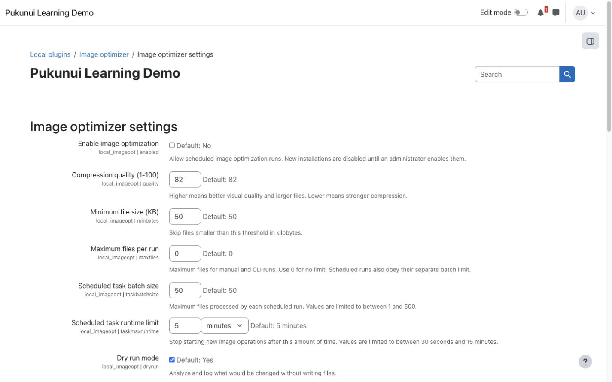
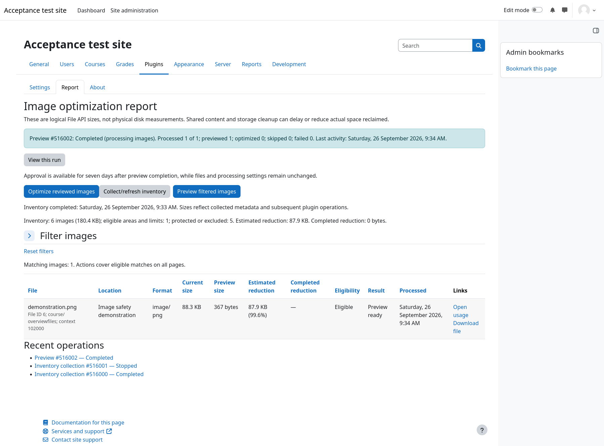
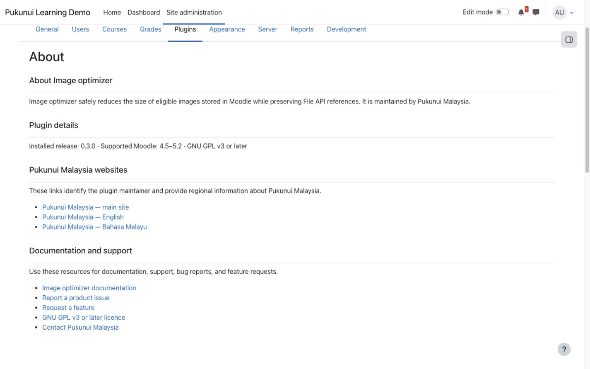

# Image optimizer

Image optimizer helps site administrators reduce the size of eligible existing JPEG and PNG images in Moodle's File API. The Settings, Report and About tabs provide a collect, preview and approve workflow. Inventory collection and previews leave original images unchanged; replacement requires explicit approval of a completed preview within seven days.

## Key features

- Collect a paginated inventory of recorded images, including protected and unsupported files, and filter or sort the report before previewing eligible matches across all filtered pages.
- Optimize only reviewed teaching-content areas: course summary and overview images, Page content, Text and media areas, and Book chapters.
- Protect submissions, feedback, private files, other unreviewed file areas, repository aliases and images referenced by aliases.
- Review estimated reductions before approving replacements. Completed logical file-size reductions are reported separately and do not measure immediate physical disk reclamation.
- Preserve file IDs, filenames, Moodle URLs, ownership, source information and supported embedded metadata when replacing images.
- Run bounded, resumable background jobs through Moodle cron, continuing after the browser closes. A shared lock prevents overlapping image operations.
- Optionally schedule inventory refreshes and preview preparation. Scheduled work never approves replacements, and new installations leave recurring work disabled.
- Use PHP GD for image processing, with configurable JPEG quality, minimum image size and optional resizing. No external image-processing service is used.

## Screenshots

### Settings

*New installations leave scheduled inventory refreshes and previews disabled. Settings control processing quality, batch limits and optional resizing. All site names and content shown are fictional demonstration data.*

### Report

*The report provides collection, filtering, preview and approval controls. Previewed images remain unchanged until an administrator approves replacement. All files and course names shown are fictional demonstration data.*

### About

*The About tab derives its release and compatibility details from installed plugin metadata and provides documentation, support and licence links.*

## Requirements

- Moodle 4.5 through Moodle 5.3 for the 0.4.3 maintenance candidate. Earlier releases may declare a narrower range; check the installed release metadata.
- PHP GD for image processing and zlib for PNG recompression.
- PHP EXIF support to read JPEG EXIF orientation; affected images are skipped if that support is unavailable.
- Working Moodle cron for background jobs, including operations started from the Report tab.
- No additional Moodle plugin or external service is required.

## Installation

Obtain the plugin ZIP from [Image optimizer on Moodle Marketplace](https://marketplace.moodle.com/plugins/local_imageopt). Open **Site administration > Plugins > Install plugins**, upload the ZIP, complete validation, and follow the displayed upgrade steps. No manual dependency installation is required.

## Configuration and use

### Configure processing

Open **Site administration > Plugins > Local plugins > Image optimizer**. Use **Settings** to configure JPEG quality, the minimum image size, images per processing batch and the maximum processing time per batch. Optionally enable resizing and set maximum width and height. Lower JPEG quality and resizing can reduce visual detail. PNG compression without resizing is lossless.

Keep a current database and file-storage backup before approving replacements: there is no built-in undo. Supported embedded metadata and orientation are retained automatically; this is not an optional EXIF-preservation setting. Unknown metadata, animation, unsupported colour encodings and unsafe inputs are skipped. Images exceeding the byte, pixel, dimension or estimated memory safeguards remain visible in the inventory but are not processed.

### Collect and preview

1. Open **Report**, choose **Collect/refresh inventory**, and confirm collection. Collection reads recorded file metadata without replacing images.
2. Wait for background collection to finish. Filter and sort the report to identify the images to review; protected and unsupported images remain identifiable.
3. Choose **Preview filtered images** and confirm. The preview includes eligible matches across every filtered page and does not replace original files.
4. Review the completed preview, estimated reductions and per-file results.

### Approve reviewed images

Choose **Optimize reviewed images** within seven days of preview completion. Confirm that you have reviewed the preview and have a current database and file-storage backup, then approve replacement. The job processes the frozen preview membership in background batches.

A preview cannot be reused after optimization has been requested. Expired previews or changed processing settings require a fresh preview. Files changed since collection or preview are skipped, and replacements must match the reviewed output. Only smaller outputs are installed. The completed report distinguishes actual replacements from estimates, skipped images and failures.

### Optional recurring preparation

Enable **Enable scheduled inventory refresh and previews** only if recurring preparation is wanted. Keep Moodle cron running and review the scheduled-task status shown in Settings. Recurring work collects inventory and prepares previews; an administrator must still approve replacements from Report. Batch controls limit each processing slice, not the total number of filtered images in a job.

### Maintenance update: 0.4.3 candidate

The following behaviour describes the 0.4.3 maintenance candidate. Publication and deployment are separate release steps; earlier builds do not provide these safeguards.

#### Retention and refresh limits

Automatic inventory collection starts at most once in 24 hours, measured from the latest manual or automatic collection start. Existing scheduled-task timing and the recurring-work enable setting remain in force. Manual refresh can run sooner, subject to the same retention safeguards.

The plugin retains the current inventory and detail required by unfinished jobs or valid seven-day previews. An unfinished approved optimization also protects its parent preview. Other inventory and per-file result detail is removed promptly; historical job references no longer keep entire inventories alive. Compact operation summaries remain for 30 days, with identifying filters removed when detail is retired. Original images and the per-file optimization ledger are not deleted by housekeeping.

There are two retained complete inventory slots and one temporary slot for collecting or retiring a generation. If another collection would exceed the protected-inventory limit, or obsolete generations have not drained, collection pauses. Existing valid previews are not silently invalidated to make space. A protected older preview can therefore delay the next daily refresh until it is consumed or expires. This limits repeated snapshots, not the size of a single inventory.

#### Existing backlogs and stalled jobs

Upgrade schedules background maintenance without deleting large tables during the upgrade request. Existing installations above the limit pause new collection while obsolete history drains. Cleanup deletes up to 500 rows per transaction and checks a 30-second or 50,000-row budget between batches. Further work is paced by at least 60 seconds. Maintenance operates even when optional recurring collection is switched off, but requires working Moodle cron.

A job with no heartbeat for 30 minutes is eligible for recovery after its next execution time, provided no worker holds the plugin lock. Recovery resumes its saved checkpoint and invalidates older task deliveries. After three recovery attempts without progress, the job is marked failed and abandoned detail becomes eligible for cleanup. A pending cancellation completes as cancelled. Recovery never approves image replacements.

In **Settings** or **Report**, review **Inventory maintenance** for retained/protected generation counts, the last maintenance heartbeat, row-removal counters, pause reasons and the latest recovery outcome. **Run maintenance now** opens a confirmation and queues the same bounded background worker; it does not perform bulk deletion in the browser. Historical links show the retained summary and **Detailed history removed** when detail has retired.

#### Operational checks

1. Before upgrade, retain a database backup and record database engine/version, inventory row count and allocated size, job statuses, oldest completion dates and the stuck job's heartbeat/checkpoint. Review scheduled and ad hoc task failures.
2. After upgrade, confirm Moodle cron executes maintenance and that obsolete row counts fall across successive slices. Collection should stay paused while the obsolete backlog blocks admission. Check that valid previews remain available and original image files are unchanged.
3. If maintenance does not advance, inspect cron, task failures and lock contention. Repeatedly requesting maintenance does not create extra cleanup workers. Recovery exhaustion requires investigation before starting replacement work again.
4. Assess physical disk reclamation separately after logical cleanup. Deleting rows may make space reusable without shrinking database files. A DBA should choose any required reclamation operation for the engine, storage layout, available headroom and maintenance window; the plugin does not run database table rebuilds or full vacuum operations. See [PostgreSQL routine maintenance](https://www.postgresql.org/docs/16/routine-vacuuming.html) and [MariaDB OPTIMIZE TABLE guidance](https://mariadb.com/docs/server/ha-and-performance/optimization-and-tuning/optimizing-tables/optimize-table).

## Privacy and permissions

Only users with Moodle's site-configuration capability can access the administration workflow. Images and personal data are not sent to an external service.

The plugin stores four groups of related data: optimization statistics, image inventory, per-file preview and replacement results, and background operation requests. These can include file owners and contexts, filenames and logical file paths, course and activity names, content fingerprints, requesting users, frozen settings and filters, progress and timestamps. Moodle's Privacy API describes the retained fields and supports discovery, export and deletion, including retained ownership metadata after an original file is deleted.

Privacy deletion removes plugin records, not the original files managed by their owning Moodle components. Earlier builds retain operation history for 30 days and keep inventories referenced by retained jobs. The 0.4.3 candidate separates compact summary retention from inventory and per-file detail, as described above; its privacy metadata also describes detail-retirement state and recovery attempts.

## Troubleshooting

- If a queued job does not progress, check Moodle cron and scheduled/ad hoc task failures. Closing the browser does not stop a job.
- If an image cannot be previewed, check its eligibility reason, minimum size, supported format and safety limits, and confirm PHP GD and zlib are available.
- If a JPEG with orientation metadata is skipped, check PHP EXIF availability.
- If approval is unavailable, complete a fresh preview using the current processing settings and approve within seven days.
- A result indicating that the image cannot be compressed means processing did not produce a smaller acceptable output. An invalid-image result indicates that the source could not be safely processed.
- If another operation is active, allow it to finish or use **Stop operation** in Report. Incomplete collection does not replace the previous complete inventory.
- If updated interface text is not visible after upgrading, purge Moodle caches and reload the page.

## Support and licence

- [Report an Image optimizer product issue](https://github.com/PukunuiMalaysia/moodle-docs/issues/new?template=product-bug.yml)
- [Request an Image optimizer feature](https://github.com/PukunuiMalaysia/moodle-docs/issues/new?template=feature.yml)
- [Report a documentation issue](https://github.com/PukunuiMalaysia/moodle-docs/issues/new?template=documentation.yml)
- [Pukunui Plugin Subscription Terms & Support Policy](https://pukunui.com/docs/policy-moodle-marketplace/)
- [Pukunui Malaysia support](https://pukunui.com/location/malaysia/)

Image optimizer is licensed under the GNU General Public License v3 or later. This documentation is licensed under [CC BY 4.0](https://creativecommons.org/licenses/by/4.0/).
