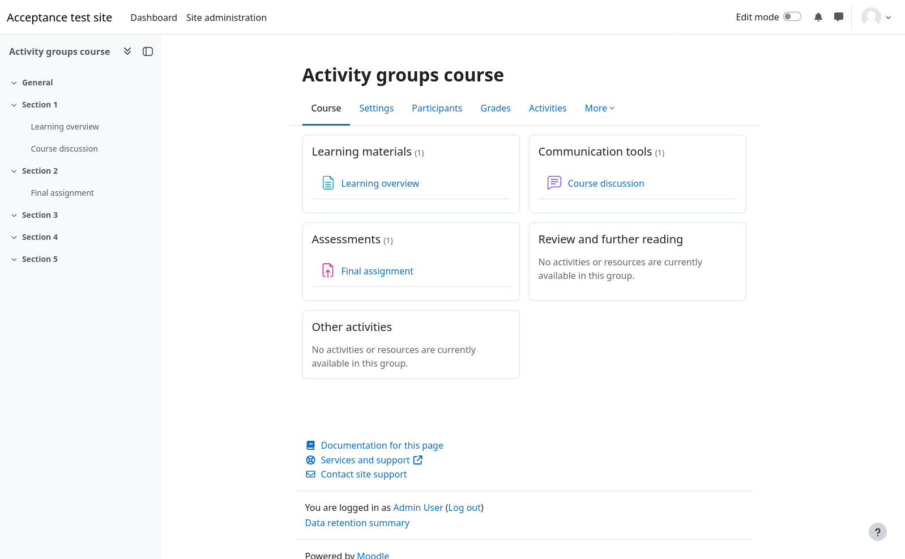
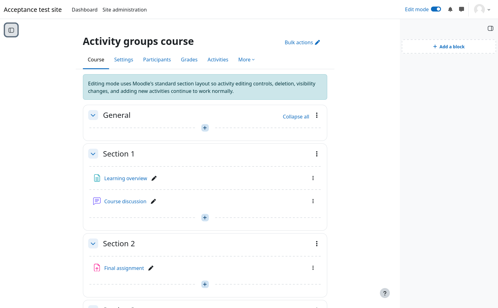
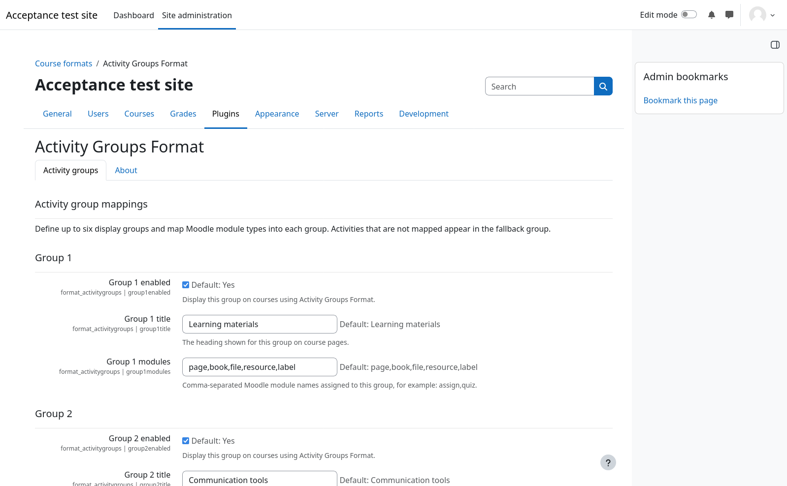
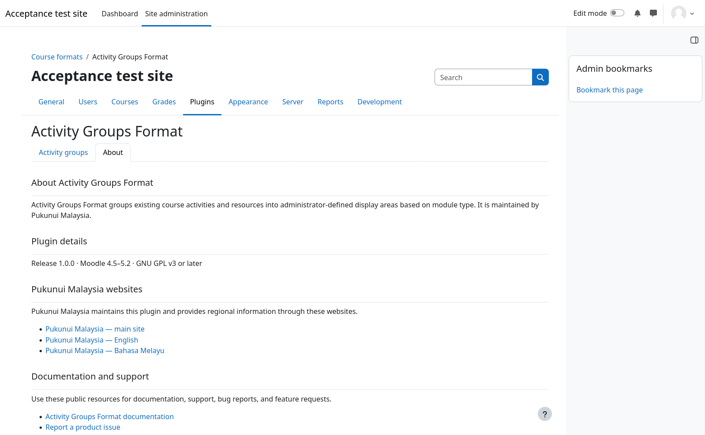

> **Pre-release product:** This product is in pre-release. Marketplace publication is pending. Its Marketplace listing may not yet be available.

# Activity Groups Format

Activity Groups Format arranges existing course activities and resources into named groups based on module type. Site administrators define the groups; teachers select the format for their courses. The grouped display does not duplicate activities or move them between course sections.

## Key features

- Configure up to six named display groups, plus a fallback group for unmatched module types.
- Start with groups for learning materials, communication tools, assessments, and further reading.
- Show the first five activities in a group, with controls to reveal more, view all, or collapse the list.
- Preserve Moodle's activity visibility, access restrictions, completion information, and normal activity links.
- Keep Moodle's standard section layout and editing controls when editing is enabled.
- Configure the format through **Activity groups** and **About** tabs in site administration.

## Screenshots

These screenshots show the release candidate on Moodle 5.2. All people, courses, activities, and content shown are fictional demonstration data.

*With editing off, activities appear in their mapped groups. Enabled groups with no matching visible activities show an explanatory message.*

*Editing mode restores Moodle's standard section layout and controls.*

*Administrators configure site-wide groups. The first group is shown here; the remaining groups and fallback title continue below.*

*The About tab identifies the installed release and declared compatibility, with documentation and support links below.*

## Requirements

- Release 1.0.0 declares support for Moodle 4.5 through Moodle 5.2.
- Use the PHP and database versions supported by the selected Moodle branch.
- No additional Moodle plugins or external services are required.
- The supplied package includes its JavaScript build; no post-install build step is needed.

## Installation

Moodle Marketplace publication is pending. Release preparation is in progress; this guide does not establish Marketplace approval or completed release validation.

For an evaluation installation, use the pre-release ZIP supplied by Pukunui. Open **Site administration > Plugins > Install plugins**, upload the ZIP, and complete Moodle's validation and upgrade steps. The package contains one `activitygroups` directory and installs at `course/format/activitygroups`.

## Configuration and use

### Configure site-wide groups

Open **Site administration > Plugins > Course formats > Activity Groups Format** and select **Activity groups**. Each group has an enable switch, a learner-facing title, and a comma-separated list of Moodle module names. Changes apply to all courses using this format.

The initial groups are:

| Group | Module names |
| --- | --- |
| Learning materials | `page,book,file,resource,label` |
| Communication tools | `forum,chat,choice,feedback` |
| Assessments | `assign,quiz,workshop` |
| Review and further reading | `url,glossary,wiki` |

Groups five and six start disabled. The fallback title starts as **Other activities**. Use the installed module's internal name, such as `assign` for Assignment or `resource` for File. A module listed in more than one enabled group appears in the first matching group. Unmatched modules appear in the fallback group.

An enabled group needs a non-empty title. Enabled groups without visible matching activities show an empty-state message. The **About** tab shows the installed release, declared Moodle compatibility, licence, documentation and support links, and maintainer details.

### Apply the format to a course

Edit the course settings and select **Activity Groups Format** as its course format. Turn editing off to see the grouped presentation. Moodle continues to determine which sections and activities the viewer may see; grouping does not grant access to hidden or restricted content.

The first five activities in each group are shown initially. Where more activities are available, use **Show … more**, **View all**, or **Collapse**. Activity ordering follows the course's existing sections and activity order within each group.

### Edit course activities

Turn editing on to use Moodle's standard section layout and add, edit, hide, show, move, and delete controls. Moving an activity between sections does not change its display group: the site-wide module mapping controls that assignment. Dragging activities between display groups is not supported.

Changing to this course format does not duplicate or reorganise the stored course modules. Switching back to another course format leaves the course's existing sections and activities in place.

## Privacy and permissions

The plugin stores site-level group settings and Moodle's normal course-format options. It stores no personal data, declares Moodle's null Privacy API provider, and sends no data to external services.

Site administrators configure the mappings. Teachers need Moodle's normal course-editing permissions to select the format or edit activities. Course access, activity visibility, and access restrictions continue to use Moodle's standard permissions.

## Troubleshooting

- **An activity appears under Other activities:** check its internal module name and whether the intended group is enabled with a non-empty title.
- **An activity appears in the wrong group:** check for duplicate module names; the first matching enabled group takes precedence.
- **A group says it has no activities:** check that its module types exist in the course and are visible to the current viewer.
- **Some activities are not initially visible:** use the group's disclosure controls to show the remaining activities.
- **Editing mode uses sections:** this is expected and preserves Moodle's standard editing controls.
- **A learner cannot see an activity:** review its normal visibility and access restrictions. A group assignment does not override them.
- **Settings changes do not appear:** save the settings, reload the course, and use Moodle's normal cache-purge tool if necessary.

## Support and licence

- [Report a product issue](https://github.com/PukunuiMalaysia/moodle-docs/issues/new?template=product-bug.yml)
- [Request a feature](https://github.com/PukunuiMalaysia/moodle-docs/issues/new?template=feature.yml)
- [Report a documentation issue](https://github.com/PukunuiMalaysia/moodle-docs/issues/new?template=documentation.yml)
- [Pukunui Malaysia](https://pukunui.com/location/malaysia/)
- [Email support](mailto:hello.my@pukunui.com)

Activity Groups Format is licensed under [GNU GPL v3 or later](https://www.gnu.org/licenses/gpl-3.0.html). This documentation is licensed under [CC BY 4.0](https://creativecommons.org/licenses/by/4.0/).
