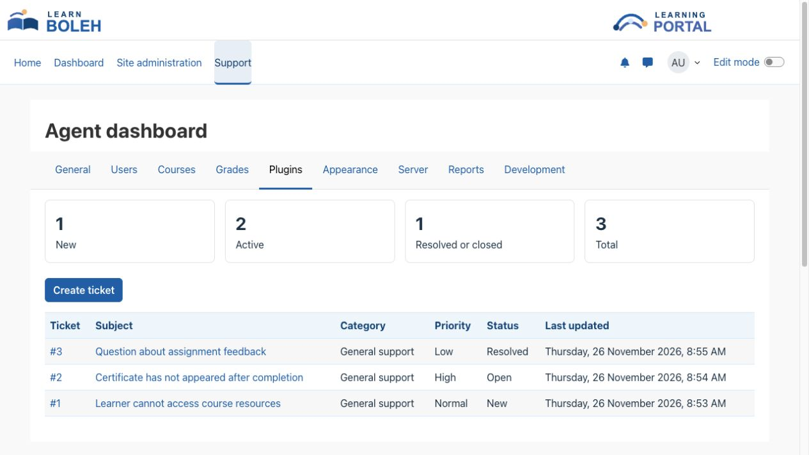
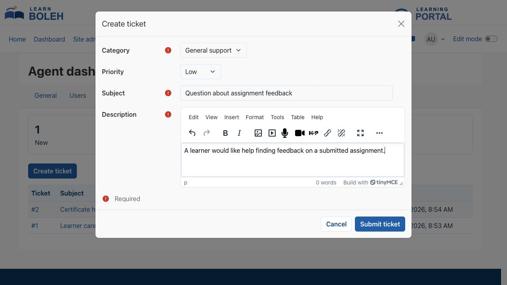
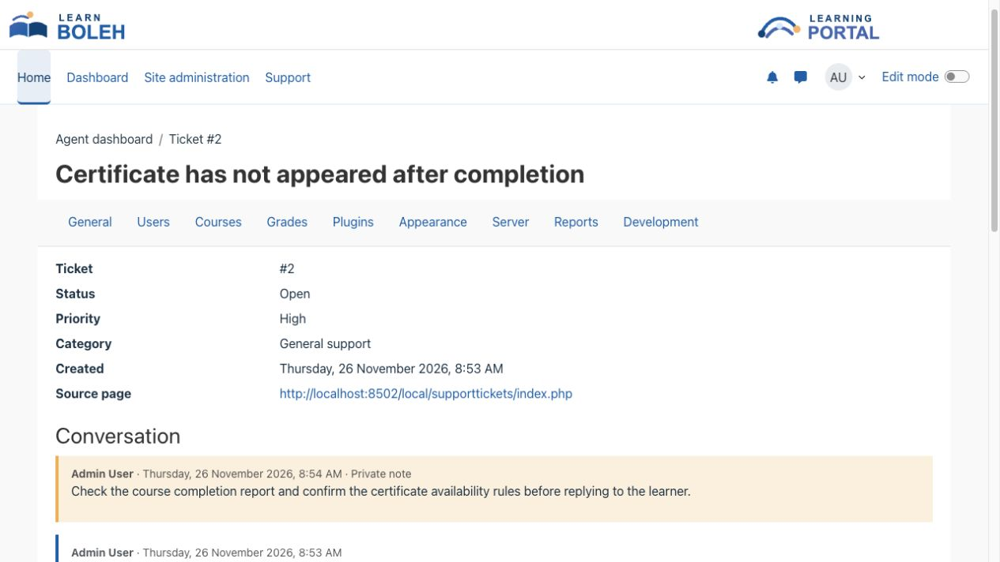
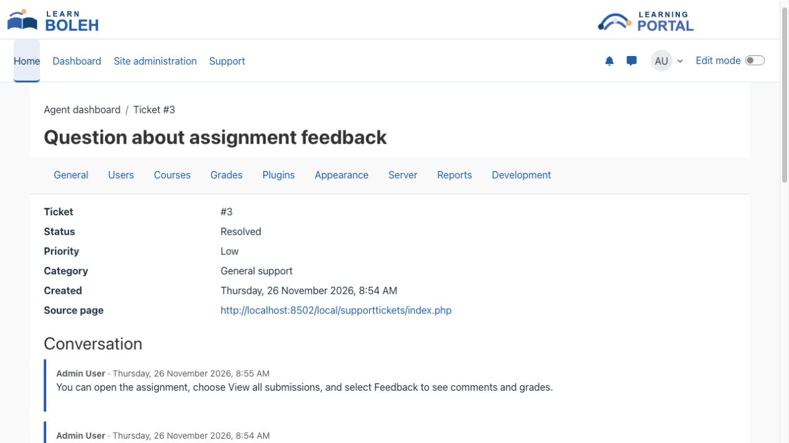
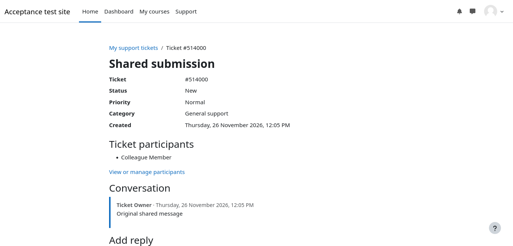

> **Pre-release product:** This product is in pre-release. Marketplace publication is pending. Its Marketplace listing may not yet be available.

# Support Tickets

Support Tickets provides native support request and ticket management inside Moodle. Authenticated users can submit and follow requests, while authorised support staff manage conversations, assignments, priorities, service targets and private notes. An optional verified guest form helps people who cannot sign in.

## Key features

- Submit tickets from Moodle with an accessible modal form and follow public replies from a personal ticket list.
- Give support staff a dashboard for assignment, status, priority, public conversation and private notes.
- Route tickets through configurable categories and optional default assignees.
- Set first-response and resolution targets by priority, with optional business-hour calculations and warning notifications.
- Allow optional ticket participants only after an administrator defines profile-field or approved-course eligibility rules. Requesters or agents must then add each eligible person explicitly.
- Recheck participant eligibility when ticket content is accessed and before notifications are sent; revoke access when an account or qualifying relationship no longer meets the configured rule.
- Offer an optional public login-support form with email verification, rate limiting and Moodle's configured reCAPTCHA support.
- Accept optional replies to authenticated tickets through Moodle's configured inbound-message subsystem. Email cannot create new tickets.
- Run SLA monitoring, participant reconciliation and expired unverified guest-ticket cleanup through Moodle scheduled tasks.

## Screenshots

These screens were captured from Support Tickets running on a local Moodle 5.2 site. The tickets and conversations are fictional examples; no client information is shown.

*The agent dashboard summarises new, active and resolved requests and lists their priority and status.*

*A requester can choose a category and priority and describe the issue without leaving Moodle.*

*Agents can record private notes while changing a ticket's status.*

*Public replies remain in the ticket conversation after resolution.*

*The requester can review the public conversation and see who is sharing the ticket. This participant example also uses fictional demonstration data.*

## Requirements

- Moodle 5.1 through Moodle 5.3 for the 2.0.1 release candidate.
- A PHP version supported by the selected Moodle release.
- Moodle cron for SLA monitoring, participant reconciliation and removal of expired unverified guest tickets.
- Working Moodle outbound email for guest verification and ticket notifications.
- Optional Moodle inbound-message configuration for requester email replies.
- Optional Moodle reCAPTCHA configuration when guest CAPTCHA is enabled.
- No additional Moodle plugin or external runtime service is required. reCAPTCHA and email behaviour use the Moodle site configuration.

## Installation

Moodle Marketplace publication is pending. If Pukunui has provided the pre-release Support Tickets plugin ZIP, open **Site administration > Plugins > Install plugins**, upload the ZIP, complete Moodle's validation and installation prompts, then open **Site administration > Plugins > Local plugins > Support Tickets**.

This component replaces the development-only `local_supportdesk` plugin and installs as `local_supporttickets`. It is a fresh installation: tickets and settings from a `local_supportdesk` development installation are not migrated. Do not remove an older development installation until its data is no longer needed. After installation, review the guest and participant settings before enabling either workflow; guest requests and participant sharing are disabled by default.

## Configuration and use

### Set up categories and support agents

Open **Site administration > Plugins > Local plugins > Support Tickets**. Assign the **Manage all support tickets** capability to the people who will respond to requests. The Manager role has it by default. Users with this capability can access the agent dashboard and manage all tickets. The separate **Add private notes to support tickets** capability controls private-note creation.

Use **Categories** to add the request types shown to users. Categories can have an optional default assignee with the manage capability. Disabling a category removes it from new ticket forms while retaining its existing tickets. Without a selected assignee, notifications go to all active users with the manage capability.

Authenticated users with **Submit support tickets** can create a request. Users with **View own support tickets** can see their own ticket list and conversations. Site administrators can adjust these capabilities in role definitions.

### Configure service targets

Use **SLA policies** to set first-response and resolution targets for a priority. Choose whether a policy counts business hours only, then set the site's business days and hours in Support Tickets settings. The scheduled SLA task checks active tickets and sends agent notifications as deadlines approach or pass. Keep cron running; warning frequency is limited to avoid repeated alerts.

### Enable guest login support (optional)

Guest requests are disabled by default. In **Settings**, enable guest submissions to add a help link to the Moodle login page. Choose whether the submitted email must match an existing Moodle account or may be any valid address. A request remains unavailable to support agents until the requester follows the one-time verification link sent by Moodle email. Verification links expire; unverified requests that remain expired are removed by a scheduled task after 24 hours.

If Moodle reCAPTCHA keys are configured, you can require Moodle's reCAPTCHA element for guest submissions. Guest requests are rate-limited. Avoid enabling open guest addresses unless your support process can handle unsolicited requests.

### Configure ticket participants (optional)

Participant sharing is disabled until an administrator enables it and configures an eligibility rule. Under **Ticket participants**, choose locked profile fields, approved courses, or both. Profile matching uses administrator-managed values and does not copy them into ticket records. Course eligibility checks current enrolment and applicable group access. Choose whether all selected conditions or any selected condition must match.

Use fields with trustworthy values, such as a locked organisation field. Confirm existing values and field visibility before using them to define who can find and share a ticket. Matching values are case-sensitive after trimming surrounding spaces. Blank values never match. Course rules should use courses whose enrolments reflect the intended sharing boundary; broad self-enrolment courses may include people who should not see a ticket.

After setting the rule, enable ticket participants. Matching a rule only makes a person eligible for selection; it does not grant ticket access. The requester or a support agent must explicitly add each person to a ticket and acknowledge that its public conversation history and attachments will be shared. The participant limit excludes the requester.

Participants can read and reply to active shared tickets. They cannot see private notes, change ticket status or invite other people. Resolved and closed tickets remain readable, but an agent must reopen one before a participant can reply. The requester or an agent can remove a participant, and a participant can leave. Removing a participant does not delete their earlier messages. Re-enabling a sharing rule does not restore revoked memberships; add people again after checking eligibility.

Participant notifications are sent individually. **Link only** is the default and does not include ticket conversation text. **Reply text and link** includes the new public reply in the email. Previously delivered email cannot be withdrawn if access is later revoked. Private notes do not trigger participant notifications.

### Use email replies (optional)

Moodle administrators can configure inbound messages and enable the Support Tickets handler. Authenticated requesters can then reply to ticket notifications by email. The handler accepts replies to an existing authenticated user's ticket; it does not create tickets from incoming email. Follow Moodle's inbound-message documentation and test the site's mail routing before enabling the handler.

## Privacy and permissions

Support Tickets stores ticket subjects, messages and attachments; requester and guest-email references; status, priority, timestamps and SLA information; and the same-site page URL from which an authenticated request began. It also stores category assignees and, when sharing is used, participant memberships, eligibility state and the users who added or removed a participant. Guest verification tokens are stored as keyed hashes. The plugin's Moodle Privacy API supports data discovery, export and deletion.

The plugin checks Moodle capabilities before displaying or changing ticket data. Support agents need **Manage all support tickets**; creating private notes also requires **Add private notes to support tickets**. Requesters use their own-ticket capabilities. Participants need both explicit ticket membership and current eligibility to read or reply. Private notes and their files are restricted to support staff.

Ticket content is not sent to a separate support service. Email and Moodle messaging use the site's configured infrastructure. If an administrator enables reCAPTCHA, its processing follows the Moodle reCAPTCHA provider and site configuration. Review your site's privacy notice and data-retention practices before enabling guest submissions, participant sharing or email notifications. Revoking ticket access cannot retract email content that was already delivered.

## Troubleshooting

- If an authenticated user cannot submit a ticket, check the **Submit support tickets** capability and confirm at least one enabled category exists.
- If a user cannot see their own ticket, check **View own support tickets** and confirm they are the requester or an active participant.
- If a support agent cannot open the dashboard, assign **Manage all support tickets** in the relevant system role.
- If an assignee or agent receives no notification, check the category assignment, Moodle messaging preferences, outgoing email configuration and cron. A successful handoff to Moodle does not confirm inbox delivery.
- If SLA notifications are late, check cron and the Support Tickets scheduled-task log. Confirm the policy is enabled and its priority and business-hour settings match the ticket.
- If a participant is missing from search, check that sharing is enabled, the selected profile values are populated and locked, course enrolment is active, and group restrictions allow access. Matching requires at least two search characters and is rate-limited.
- If participant access has been revoked, verify the current rule and explicitly add the person again. Restoring a profile value or enrolment does not restore a revoked membership.
- If a participant can see a reply but not a private note, that is expected. Private notes are only available to authorised support staff.
- If guest verification email is not received, check outbound email, the verification expiry and configured CAPTCHA. An unverified request is not visible to agents and is later removed by the cleanup task.
- If email replies do not appear, confirm Moodle inbound messaging is configured, the Support Tickets handler is enabled, and the sender is the authenticated ticket requester. Email cannot open a new ticket.

## Support and licence

- [Report a Support Tickets product issue](https://github.com/PukunuiMalaysia/moodle-docs/issues/new?template=product-bug.yml)
- [Request a Support Tickets feature](https://github.com/PukunuiMalaysia/moodle-docs/issues/new?template=feature.yml)
- [Report a documentation issue](https://github.com/PukunuiMalaysia/moodle-docs/issues/new?template=documentation.yml)
- [Pukunui Malaysia support](https://pukunui.com/location/malaysia/)

Support Tickets is licensed under the GNU General Public License v3 or later. This documentation is licensed under [CC BY 4.0](https://creativecommons.org/licenses/by/4.0/).
